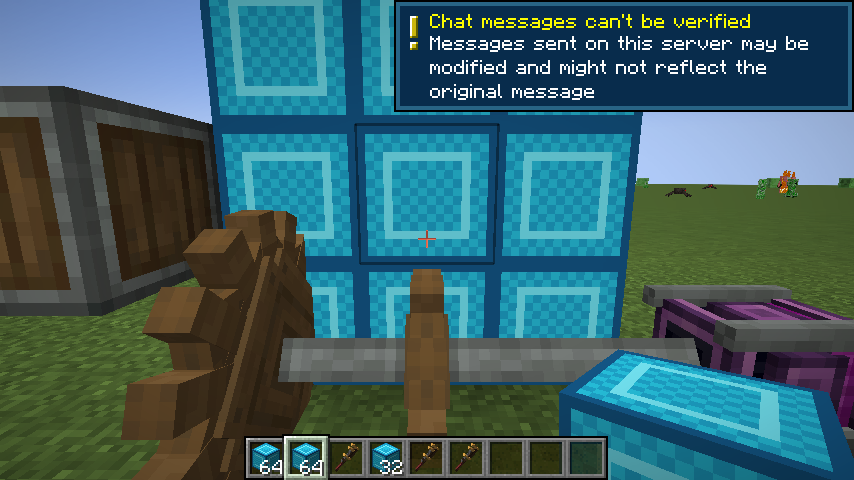

# Create and addons, hot-loaded

Create 6.0.10, with its bundled Flywheel 1.0.6, Ponder 1.0.82 and Registrate, loaded into a running NeoForge 1.21.1 client at the title screen, with no restart. The client then joined a dedicated server running Create and played normally.

## Addons

Five popular Create addons hot-loaded on top of Create, each as its own hot-load, and the client then joined a server running all of them. 29 of 29 checks passed (`docs/create-addons-report.txt`), on NeoForge 21.1.267.

| Addon | Version | Load time | Blocks / items |
| --- | --- | --- | --- |
| Create: Bells & Whistles | 0.4.7 | 0.2 s | 36 / 36 |
| Create: Copycats+ | 3.0.11 | 3.2 s | 46 / 45 |
| Create: Connected (+ bundled Sable Companion) | 1.3.3 | 3.0 s | 92 / 84 |
| Create Crafts & Additions | 1.7.2 | 0.8 s | 22 / 48 |
| Create Deco | 2.1.3 | 0.9 s | 389 / 402 |

Extra fixes the addons needed:

| Problem | Fix |
| --- | --- |
| Copycats+ adds overrides (`getAppearance`, `useWithoutItem`, `getBlockEntity`) to Create blocks that are already loaded | The method a call resolves to today (a superclass method, or an interface default like `IBE.getBlockEntity`) gets the dispatch prologue, with the companion registered as the override for that class |
| `@Mutable` final fields (`VoxelShape.shape`) are still final on the loaded class | Writes outside the declaring class's own initialiser are rerouted to a privileged setter |
| Mixin handlers that call `super.m()` can't do that from a companion | `findSpecial` with the host as special caller, which is exactly the host's own `invokespecial` |
| Companions refer to hot-loaded *library* modules (Registrate) | Libraries are made readable by every module too |
| A mod requiring a newer NeoForge or a missing dependency | Checked before loading, like FML's own check, with a clear error |

## Create checks (same run, `docs/create-addons-report.txt`)

| Check | Result |
| --- | --- |
| Registrate (library), Flywheel, Ponder, Create loaded from one jar | ✅ ~14 s total |
| Mixins on already-loaded classes: Flywheel 14, Ponder 11, Create 47 | ✅ 154 methods moved, 9 fields, 46 interfaces |
| Create registered 643 blocks, 699 items | ✅ |
| Cogwheel block and item models baked, name translated | ✅ |
| 117 Create + Ponder network packet types registered | ✅ |
| Joined a dedicated server running Create | ✅ registry sync and network negotiation accepted |
| Server-placed creative motor → shaft → cogwheels, turning at 16 rpm on the client, drawn by Flywheel | ✅ |
| Server-given Create wrench | ✅ |

## What it took (on top of the [mixin splitter](SPLITTER.md))

| Problem | Fix |
| --- | --- |
| Create bundles Flywheel, Ponder and Registrate (jar-in-jar) | Expand `META-INF/jarjar`, load nested jars first; plain library jars become modules |
| Access transformers can't change already-loaded classes | Register them with FML's AT engine (it applies to everything that loads later). For loaded classes, the rewriter checks real JVM access rules on every reference from hot code and reroutes illegal ones through privileged method handles |
| Classes made public by an AT but loaded as package-private can't even be named in a call-site descriptor | Erase them to their nearest public superclass throughout hot code. Every access involving them goes through `invokedynamic`, which keeps the real types in strings |
| Mixin's static accessor bodies call private members, normally widened when the target loads | Same rerouting |
| Create overrides `HangingEntity.recalculateBoundingBox`, final in vanilla (AT `-f`); Ponder overrides `AbstractWidget.render` | Final-method shim: the loaded method gets a dispatch prologue, and overrides are renamed as they load. `super` calls bypass the dispatch once |
| Mixins on classes loaded later make game modules reference the new mod | Every game module is made to read each hot module |
| Create creates registries in static initialisers and writes straight into the root registry | Registry creation reopened and root registry unfrozen for the hot-load window; NeoForge's normal freeze closes it |
| Mods look themselves up in `ModList` while constructing | Listed before construction, as FML does |
| One-time startup events | Replayed for the new mods, in startup order: `NewRegistryEvent`, data-pack registries, `RegisterEvent`, configs, capabilities, block-entity blocks, client extensions, menu screens, reload listeners, entity layers and renderers, key mappings, particles, colour handlers, common and client setup (with `enqueueWork`), IMC, load complete, network payloads |
| APIs that only work "during client loading" (render layers) | `ClientModLoader.loading` set during the replay |
| Create switches on NeoForge's milk fluid; the server had it, the client didn't (registry mismatch on join) | NeoForge's own milk registration rerun when a hot mod enables it |
| Some code calls `getFileName()` on every stack frame | Companions get a source-file name |

## Still to do

- Not yet replayed: GUI layers (Create's goggle overlay), tooltip components, item decorations, named render types, dimension effects.
- **Ponder's GUI** (menus, ponder scenes) isn't exercised by the test yet. It depends on the final-method shim for `AbstractWidget.render`.
- **Production launch.** Tested in a dev client on a full JDK; Modrinth's runtime lacks `jdk.attach` (see FEASIBILITY.md).
- **Load time.** ~14 s for Create, mostly the mixin rebuild of 72 loaded classes. Not yet optimised.
