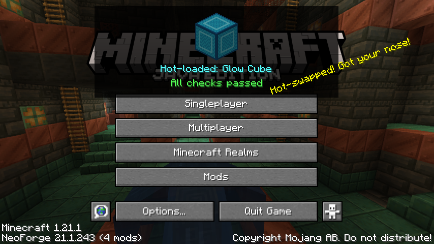
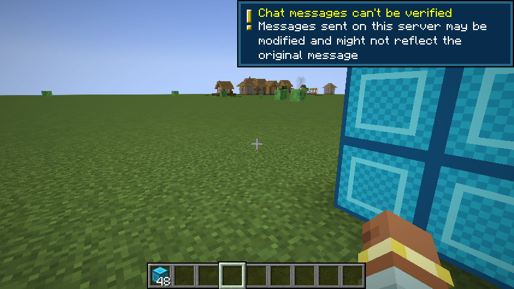

# Hot-loading mods into a running game: feasibility (NeoForge 1.21.1)

**Verdict: possible.** All three building blocks work in a real NeoForge 1.21.1 client. Create needs one more big piece, a "mixin splitter", which is real engineering work but no longer a research question.

Built from NeoForge, FML, ModLauncher and JDK sources only. No Hotwire code was used or looked at.

## What was tested

Automated runs in a real client (`loader/`, `runClient`). All checks passed (`docs/spike-report.txt`).

| Step | Result | Time |
| --- | --- | --- |
| Load a mod jar into the running game (new module, game classloader, FML container, `ModList`) | ✅ | 25–70 ms |
| Unfreeze registries, register its block and item, freeze again | ✅ block state ids, block-item map, light level all correct | included above |
| Add its assets, reload resources | ✅ texture, block model, item model, translation | ~1–3 s |
| Join a dedicated server running the same mod | ✅ registry sync accepted, server-placed blocks visible, server-given item in hotbar | 2.9 s |
| Change a loaded Minecraft class's code through a hidden companion class | ✅ existing title-screen splash changed live | 250 ms (incl. agent attach) |

### Startup-only caches

Most of the work is finding caches the game fills once at startup. Found so far:

- `ItemRenderer` maps items to model locations at startup. Fixed by calling `ItemModelShaper.register` for new items.
- NeoForge's `ResourcePackLoader.modResourcePacks` is built once. Fixed by adding the jar to it.
- `CreativeModeTabs.CACHED_PARAMETERS`. Cleared so the tabs rebuild.

Create will surface more: block entity renderers, entity renderers, particles, sounds, color handlers, render types, menus, data maps, network payloads.

## Create: what it needs

Create 6.0.10 bundles Flywheel, Ponder and Registrate. `tools/MixinAudit.java` counted their mixins (`tools/create-mixin-audit.tsv`):

- **101 mixins** across **82 target classes**.
- **65 of those classes are already loaded** at the title screen (`docs/create-mixin-targets-loaded.txt`): `Minecraft`, `Entity`, `Block`, `Level`, `LevelRenderer`, `RenderSystem`…
- **83 mixins** hit those loaded classes:
  - 41 accessor-only
  - 38 with injectors
  - 7 add fields
  - 8 add methods
  - 5 add interfaces

A standard JVM can swap method bodies of a loaded class, but it can't add fields, methods or interfaces. Mixin also merges every injector handler into the target as a new method. So none of these 83 can be applied the normal way.

### The plan: a mixin splitter

1. Run the real Mixin library on the class's current bytes plus the new configs. That produces the class as it *would* be. We don't reimplement injection semantics.
2. Compare it with the loaded shape and split the difference:
   - **Changed method bodies:** keep in the class and redefine (allowed).
   - **Added methods** (handlers, `@Unique`): move into a hidden nestmate companion, called via `invokedynamic`. **Proven in this spike.**
   - **Added fields:** a side table per instance, held in the companion.
   - **Added interfaces / accessors:** the new mod's own classes load fresh, so rewrite their `checkcast`, `instanceof` and interface calls to go through the companion instead.
3. Targets that aren't loaded yet (17 of 82) get Mixin's normal treatment when they load.

## Risks

- **Getting `Instrumentation`.**
  - The game only needs `java.instrument`, and every runtime here has it.
  - The *attacher* needs `jdk.attach`. **Modrinth's bundled Zulu JRE doesn't have it**; the official launcher's runtime does.
  - Fallbacks:
    - Attach using any other Java on the PC that has `jdk.attach`.
    - Have Conduit's restart system add `-javaagent:` once.
    - Give a one-time JVM-argument tip.
- **Dynamic agents** print a warning on Java 21+, and future JDKs may require a flag. A `-javaagent` fallback avoids both.
- **Mods that do real work at startup** (data generation, `FMLCommonSetupEvent`, `InterModComms`, configs) need those events replayed for the new mod.
- **Existing worlds and objects:** new fields start at default values on objects that already exist. Usually fine before joining a server, which is when Conduit hot-loads.
- **Unloading or swapping mods** is much harder than adding them and isn't covered here.

## Rough plan

1. **Lifecycle replay + startup caches** (common/client setup, renderers, sounds, particles, menus, payloads), tested with a mid-sized content mod.
2. **Mixin splitter**, tested first on Ponder (12 accessors), then Flywheel (24 mixins, the renderer), then Create.
3. **Create + addons** on a dedicated server.
4. **Wire into Conduit**: Conduit downloads, then hot-loads instead of restarting; fall back to restart when something can't be hot-loaded.
5. **Port** to NeoForge 26.x, Forge and other Fabric versions.

Phase 2 is the big one. It's where the work and the remaining risk are.

## Layout

- `loader/`: the spike (`HotLoader`, `HotResources`, `jvm/JvmAccess`, `jvm/Companions`, `RedefineExperiment`, `SpikeHarness`).
- `testmod-hotblock/`: the test mod and its dedicated server (`runServer`, offline, port 25680).
- `tools/MixinAudit.java`: mixin audit tool.
